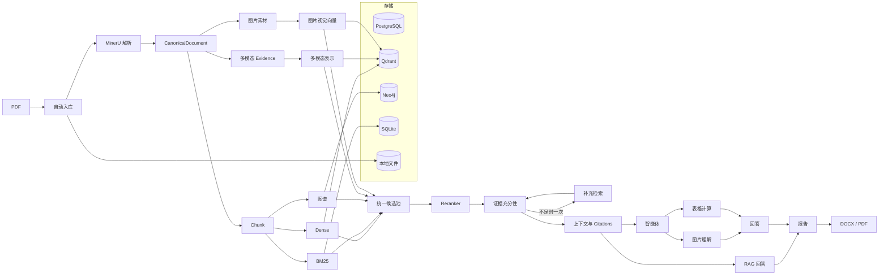

# KnowledgeScope

**面向 PDF 的可追溯多模态 Agentic RAG 与报告创作平台。**

上传 PDF 后自动完成解析与多模态索引，通过统一检索与受限工具调用的智能体问答，把带真实来源的
分析结果写回报告并导出 DOCX/PDF。

[快速开始](#快速开始) · [核心能力](#核心能力) · [系统架构](#系统架构) · [配置](#配置) · [评测](#评测)

[](https://www.python.org/)
[](https://fastapi.tiangolo.com/)
[](https://vuejs.org/)
[](https://www.postgresql.org/)
[](https://qdrant.tech/)
[](https://neo4j.com/)
[](https://github.com/opendatalab/MinerU)

## 核心能力

| 能力 | 说明 |
| --- | --- |
| PDF 自动入库 | 网页上传 PDF 后由后台 worker 自动完成解析、分块与索引；状态可查、失败可重试、进程重启可恢复。 |
| 文档解析 | MinerU 输出 `CanonicalDocument`，保留标题、正文、表格、公式、图片的页码与来源块。 |
| 多模态 Evidence | text / image / table / formula 统一为可追溯 Evidence，支持 caption、上下文、Markdown 与 LaTeX 表示。 |
| 混合检索 | Dense、BM25、知识图谱、多模态表示与原生图片视觉向量五路候选，经统一候选池与本地 reranker 重排。 |
| 原生视觉检索 | 使用本地 `Qwen/Qwen3-VL-Embedding-2B` 编码原始图片，按模型指纹写入独立 Qdrant 集合，支持文本查图。 |
| 智能体问答 | 检查对象、年份、指标与原图需求是否被逐条 Evidence 支持，必要时执行一次补充检索；按需调用图片理解或表格计算工具。 |
| 视觉理解 | 通过 OpenAI 兼容接口接入本地视觉模型，支持图片描述、图表分析与图片型表格提取。 |
| 表格计算 | 将 PDF 表格转为结构化数据，支持筛选、排序、汇总、增长率与跨表/跨文档对比，全部确定性计算。 |
| 报告创作 | 可信回答可一键「插入报告」并关联真实来源，支持编辑、AI 辅助写作与 DOCX/PDF 导出。 |
| 数据分析与图谱 | 外部 PostgreSQL 只读分析（ChatBI）与文档实体关系图谱、图检索和可视化。 |

## 系统架构



## 快速开始

环境要求：Python 3.12 与 `uv`、Node.js 与 `npm`、Docker Compose、MinerU 独立运行时；
图片理解需本地 Ollama 或任意 OpenAI 兼容视觉服务。

```bash
uv sync --group embedding-benchmark --group reranker-benchmark
cp .env.example .env
docker compose up -d
uv run alembic upgrade head
uv run uvicorn knowledge_scope.api.app:app --reload
```

```bash
cd frontend
npm install
npm run dev
```

打开 `http://localhost:5173`，创建知识库并上传 PDF。默认开启自动入库
（`KNOWLEDGE_SCOPE_INGESTION_ENABLED=true`），后台会依次完成解析、分块、文本/BM25/多模态/
视觉索引；失败可在文档列表中重试。MinerU 需单独安装并确保 `mineru` 命令可用，如使用独立环境，
可设置 `KNOWLEDGE_SCOPE_MINERU_COMMAND`。

### 可选：本地视觉模型与图片检索

```bash
# 图片理解（本地 Ollama 示例）
export KNOWLEDGE_SCOPE_VLM_ENABLED=true
export KNOWLEDGE_SCOPE_VLM_BASE_URL=http://127.0.0.1:11434/v1
export KNOWLEDGE_SCOPE_VLM_MODEL=qwen3-vl:8b

# 原生图片向量检索
export KNOWLEDGE_SCOPE_VISUAL_EMBEDDING_ENABLED=true
export KNOWLEDGE_SCOPE_VISUAL_MODEL_PATH=/path/to/qwen3-vl-embedding-2b
export KNOWLEDGE_SCOPE_VISUAL_DEVICE=cuda
```

已有文档可单独构建视觉索引：

```bash
uv run knowledgescope visual-index build \
  --knowledge-base-id <knowledge_base_id> --mode all
```

## 使用指南

1. **知识库**：创建知识库并上传 PDF，查看解析结果、图片数与视觉索引状态。
2. **AI 问答**：选择知识库提问，获得流式回答与可点击来源；支持「智能 / 深度 / 快速」检索模式。
3. **智能体模式**：开启「✦ 智能体」后自动检查证据充分性、按需补充检索，并调用图片理解或表格计算工具。
4. **报告创作**：把回答插入报告章节并关联来源，编辑后导出 DOCX/PDF。
5. **数据分析**：注册外部 PostgreSQL 数据源，用自然语言生成受约束的只读 SQL。
6. **知识图谱**：构建并浏览文档实体关系图。

示例问题：

- 「2023 年越南的 GDP 是多少？不同表格中的数值分别是多少？」
- 「请分析图 1，说明 2023 年季度销售额的变化趋势和峰值季度。」
- 「表 1 中越南 2024 年 GDP 比 2023 年增长百分之几？」
- 「对比表 1 和表 2 中越南、泰国 2024 年的 GDP 差异与相对变化。」

## 配置

配置通过 `KNOWLEDGE_SCOPE_` 前缀环境变量或 `.env` 注入，完整默认值见 `.env.example`。

| 变量 | 说明 |
| --- | --- |
| `KNOWLEDGE_SCOPE_DATA_DIR` | 解析产物、Evidence 等本地数据根目录 |
| `KNOWLEDGE_SCOPE_DATABASE_URL` | PostgreSQL 连接串 |
| `KNOWLEDGE_SCOPE_MINERU_COMMAND` | MinerU 可执行文件路径或命令名 |
| `KNOWLEDGE_SCOPE_LLM_BASE_URL` | OpenAI 兼容文本 LLM 地址 |
| `KNOWLEDGE_SCOPE_LLM_MODEL` | 文本 LLM 模型名，按部署配置 |
| `KNOWLEDGE_SCOPE_INGESTION_ENABLED` | 是否自动执行上传入库 |
| `KNOWLEDGE_SCOPE_INGESTION_VISUAL_MODE` | 视觉索引策略：`all` / `selective` |
| `KNOWLEDGE_SCOPE_VISUAL_EMBEDDING_ENABLED` | 是否启用原生图片视觉向量 |
| `KNOWLEDGE_SCOPE_VISUAL_MODEL_PATH` | 本地视觉 embedding 模型路径 |
| `KNOWLEDGE_SCOPE_VLM_ENABLED` | 是否启用视觉模型适配器 |
| `KNOWLEDGE_SCOPE_VLM_BASE_URL` | OpenAI 兼容视觉服务地址 |
| `KNOWLEDGE_SCOPE_VLM_MODEL` | 视觉模型名称 |
| `KNOWLEDGE_SCOPE_AGENT_ENABLED` | 是否启用智能体问答 |
| `KNOWLEDGE_SCOPE_AGENT_MAX_ROUNDS` | 规划轮数上限，默认 3 |
| `KNOWLEDGE_SCOPE_AGENT_MAX_TOOL_CALLS` | 工具调用上限，默认 3 |
| `KNOWLEDGE_SCOPE_AGENT_EVIDENCE_SUFFICIENCY_ENABLED` | 是否启用证据充分性检查 |
| `KNOWLEDGE_SCOPE_RAG_CACHE_BACKEND` | 检索缓存：`memory` / `redis` / `off` |

## 评测

数字用于回归与配置选择，不同评测集不可横向比较。

### 文本检索

| 策略 | Hit@1 | Hit@3 | Hit@10 | MRR |
| --- | ---: | ---: | ---: | ---: |
| Dense | 77.78% | 83.33% | 86.11% | 0.8079 |
| Dense + Sparse | 80.56% | 97.22% | 100.00% | 0.8852 |
| Dense + Graph | 77.78% | 91.67% | 94.44% | 0.8449 |

### 原生视觉检索

| 策略 | Recall@5 | Recall@10 | MRR |
| --- | ---: | ---: | ---: |
| 文本 caption/context | 25.0% | 35.7% | 0.197 |
| 选择性视觉索引 | 92.9% | 92.9% | 0.866 |
| 全量视觉索引 | 92.9% | 96.4% | 0.871 |

### 智能体问答

| 指标 | 结果 |
| --- | ---: |
| 工具选择 | 15/15 |
| 证据充分性判断 | 9/9 |
| 补充检索触发 | 9/9 |
| 关键证据覆盖 | 15/15 |
| 图片工具调用 | 15/15 |
| 端到端成功 | 14/15 |
| 平均 / P95 延迟 | 42.4s / 81.1s |

30 题端到端评测：端到端成功 26/30，引用结构 26/27，确定性工具数值 12/12。

## 项目结构

```text
src/knowledge_scope/
├── parsing/  chunking/  evidence/   PDF 解析、分块与多模态 Evidence
├── ingestion/                       上传后的自动入库编排
├── retrieval/                       dense / sparse / graph / multimodal / visual
├── rag/  agent/                     RAG、证据充分性与受限工具调用
├── vision/  table_analysis/         视觉理解、PDF 表格计算
├── reports/  chat/                  报告创作、对话与可信回答
├── chatbi/  mcp/                    外部数据分析与 MCP 服务
├── documents/  knowledge_bases/     文档存储与知识库
frontend/                            Vue 3 + TypeScript
scripts/  docs/  tests/              评测脚本、文档、测试
alembic/  compose.yaml               数据库迁移与本地基础设施
```

## 开发与测试

```bash
uv run ruff check .
uv run ruff format --check .
uv run pytest -q

cd frontend && npm run test && npm run type-check && npm run lint
```

## 文档

| 主题 | 文档 |
| --- | --- |
| 系统架构与数据流 | [Architecture Handoff](docs/development/multimodal-agentic-rag-handoff-architecture.md) |
| 真实指标与技术取舍 | [Metrics Handoff](docs/development/multimodal-agentic-rag-handoff-metrics.md) |
| PDF 自动入库 | [Auto Ingestion](docs/architecture/auto-ingestion.md) |
| 原生视觉检索 | [Visual Retrieval](docs/architecture/visual-retrieval.md) |
| 智能体问答 | [Agentic RAG](docs/architecture/agentic-rag.md) |
| 多模态安全边界 | [Multimodal Safety](docs/architecture/multimodal-safety.md) |
| PDF 表格计算 | [Table Analysis](docs/architecture/table-analysis.md) |
| 视觉理解 | [Vision Analysis](docs/architecture/vision-analysis.md) |
| 报告创作 | [Report Workspace](docs/architecture/report-workspace.md) |
| MinerU 集成 | [MinerU](docs/integrations/mineru.md) |

## License

本项目基于 [MIT License](LICENSE) 开源。
