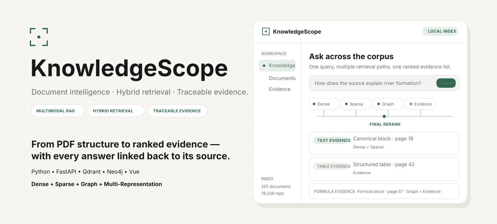
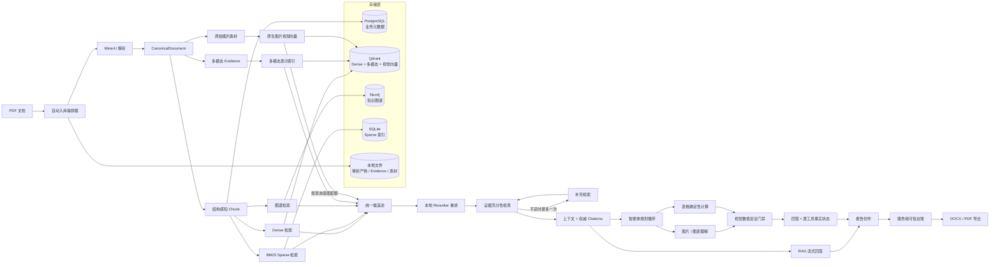

# KnowledgeScope

**面向 PDF 的可追溯多模态 Agentic RAG 与报告创作平台。**

KnowledgeScope 把 PDF 解析为解析器无关的 `CanonicalDocument`，在文本、图片、表格与公式之上构建
带完整来源 lineage 的 chunks 与 Evidence；上传后自动完成解析与四类索引，再通过统一检索、
原生图片向量检索、受限工具调用的智能体问答，把带真实来源的分析写回报告并导出 DOCX/PDF。

[快速开始](#快速开始) · [核心能力](#核心能力) · [系统架构](#系统架构) · [可信与安全边界](#可信与安全边界) · [评测](#评测) · [文档](#文档)

[](https://www.python.org/)
[](https://fastapi.tiangolo.com/)
[](https://vuejs.org/)
[](https://www.postgresql.org/)
[](https://qdrant.tech/)
[](https://neo4j.com/)
[](https://github.com/opendatalab/MinerU)

## 简介

大多数 RAG 系统只擅长处理"一段文本"。真实业务文档中的图、表、公式和跨页结构，往往才是
问题的核心；而一句看似流畅的回答，如果无法指回原文的具体页码与来源块，也很难真正用于核验。

KnowledgeScope 围绕三个目标设计：

- **可追溯**：回答中的 citation 由应用生成，可回到知识库、文档、页码、source block 与
  Evidence；表格数字来自确定性工具，图片结论来自可配置视觉模型并标注复核状态。
- **完整多模态闭环**：从 PDF 自动入库、四类检索、原生图片向量召回，到智能体工具调用，
  再到把分析结果插入报告并导出 DOCX/PDF，全部在一个系统中完成。
- **可信优先于流畅**：应用层负责事实来源标记、视觉数值门禁、服务端可信台账与报告插入校验；
  证据不足时明确说明缺什么，而不是拼凑答案。

系统保留 FastAPI、Vue、PostgreSQL、Qdrant、Neo4j 与 MinerU 的技术栈，不引入额外的
Agent 框架；所有向量与图索引都是可重建的派生状态，业务数据与检索数据分层存放。

## 核心能力

| 能力 | 说明 |
| --- | --- |
| **PDF 自动入库** | 网页上传 PDF 后由后台单线程 worker 自动执行：MinerU 解析 → 结构感知分块 → Dense 索引 → BM25 索引 → 多模态 Evidence/表示 → 原生图片视觉索引 → 发布 → 校验；状态可查、失败可重试、进程重启可恢复。 |
| **文档解析** | MinerU 解析 PDF，输出 `CanonicalDocument`；标题、正文、表格、公式、图片均保留页码、block 与资产 lineage。 |
| **结构化分块** | 基于规范文档生成可重复的结构感知 chunk，保留章节、页码、来源块与跨 block 关系。 |
| **多模态 Evidence** | text / image / table / formula 均可作为 Evidence，并拥有 caption、上下文、Markdown、LaTeX 等可搜索表示；权威内容始终回指 Evidence。 |
| **混合检索** | Dense（Qdrant）、BM25 Sparse（SQLite）、知识图谱（Neo4j）、多模态表示与原生图片视觉向量五路候选，经统一候选池与本地 reranker 重排，按查询意图应用视觉配额。 |
| **原生视觉向量检索** | 使用 `Qwen/Qwen3-VL-Embedding-2B` 直接编码原始图片像素，写入按模型指纹命名的独立 Qdrant 集合；支持文本查询召回图片、按知识库过滤与独立重建（默认关闭，需显式启用）。 |
| **证据约束 RAG** | 统一上下文组装、确定性 citation marker、流式 SSE 回答；引用保留文档、页码、block 与 Evidence lineage。 |
| **证据充分性检查** | 智能体回答前检查对象、年份、指标与原图需求是否被逐条 Evidence 支持；必要时最多执行一次针对性补充检索，并记录前后覆盖与轨迹。 |
| **智能体问答** | 「✦ 智能体」模式在检索候选之上进行受限规划，最多 3 轮规划/3 次工具调用；可用工具为图片理解/图表分析、PDF 表格确定性计算，知识库检索作为固定前置步骤。 |
| **视觉理解（可选）** | 通过 OpenAI 兼容协议接入独立 VLM，支持图片描述、图表趋势分析、图片型表格提取；结果始终标注需人工核对。 |
| **表格计算** | 将 PDF 表格解析为结构化数据，支持筛选、排序、汇总、增长率与跨表/跨文档对比；全部使用确定性规则计算，单位按结果列渲染，拒绝不可靠的复杂合并单元格。 |
| **可信台账与安全门禁** | 逐工具 `fact_status`、视觉数值输出门禁、HMAC 服务端可信台账；报告自动插入必须绑定服务端生成记录，客户端不能自称"已核验"。 |
| **报告创作** | 标准 RAG 或智能体回答可一键「插入报告」，同时写入真实来源；报告支持编辑、AI 辅助写作与 DOCX/PDF 导出。 |
| **数据分析** | 已注册的外部 PostgreSQL 数据源可通过受策略约束的只读 SQL 查询与 ChatBI 工作区分析，并支持本地 stdio MCP 调用。 |
| **知识图谱** | 从文档抽取实体与关系，提供图检索、实体链接与知识图谱可视化。 |

## 系统架构



- PostgreSQL 保存知识库、文档、对话、报告与来源引用等业务元数据；
- Qdrant 保存 dense chunk 向量、多模态 representation 向量与原生图片视觉向量；
- Neo4j 保存有证据支撑的实体与关系；
- SQLite 保存 BM25 sparse 索引；
- 本地文件保存解析产物、Evidence 与原始素材；
- 所有派生索引均可重建，跨存储操作不构成分布式事务；视觉索引使用 generation + pointer 单写切换，失败时旧索引仍可用。

## 快速开始

### 环境要求

- Python 3.12 与 [`uv`](https://docs.astral.sh/uv/)
- Node.js（建议 20 LTS 或更高）与 `npm`
- Docker Compose（本地基础设施）
- MinerU 独立运行时（PDF 解析必需，见 [MinerU 集成](docs/integrations/mineru.md)）
- 可选：NVIDIA GPU（本地 embedding / reranker / 视觉编码与 MinerU 解析建议使用 GPU）
- 可选：Ollama 或任意 OpenAI 兼容视觉服务（图片理解功能）

### 1. 启动基础设施与后端

```bash
# 本地 embedding / reranker 需要模型运行时依赖
uv sync --group embedding-benchmark --group reranker-benchmark
cp .env.example .env
docker compose up -d
uv run alembic upgrade head
uv run uvicorn knowledge_scope.api.app:app --reload
```

`compose.yaml` 只启动 PostgreSQL、Qdrant 与 Neo4j；API 与前端分别启动。后端默认地址为
`http://127.0.0.1:8000`。若要使用共享检索缓存，可参考下文「配置」启动 Redis。

`.env` 是本地配置且已被 Git 忽略。请不要提交密码、API Key 或 Token；可参考
`.env.example` 的注释按需填写。

### 2. 启动前端

另开一个终端：

```bash
cd frontend
npm install
npm run dev
```

前端默认地址为 `http://localhost:5173`，Vite 会将 `/api` 请求代理到本地后端。

### 3. 上传第一份 PDF

在「知识库」中创建知识库并上传 PDF。默认开启自动入库（`KNOWLEDGE_SCOPE_INGESTION_ENABLED=true`），
后台 worker 会自动完成解析、分块、四类索引与视觉索引校验；文档列表实时展示
「正在解析 / 正在建立视觉索引 / 已就绪 / 处理失败」等状态，失败时提供「重试处理」。

- 同一时间只执行一个重型入库任务，GPU 阶段串行执行，避免 12GB 显存 OOM；
- 进程异常退出后重启可识别未完成任务并自动恢复；
- 已完成文档不支持原地强制重建（接口返回 409），如需重建请删除文档后重新上传；
- 无图片 PDF 正常完成，视觉索引状态为 `skipped_no_images`；
- 知识图谱不参与自动入库，仍通过既有图构建流程生成。

MinerU 不是本项目 Python 依赖的一部分，需单独安装并确保 `mineru` 命令可用；如使用独立环境，
可设置 `KNOWLEDGE_SCOPE_MINERU_COMMAND` 指向完整路径。首次运行 embedding / reranker 时
会从 Hugging Face 下载模型缓存（`Qwen/Qwen3-Embedding-0.6B` 与本地 BGE reranker）。

<details>
<summary>可选：手动 / 批量处理已有文档</summary>

对于无界面环境或已有语料，也可以使用 CLI 手动执行同一流水线：

```bash
uv run knowledgescope parse-document <document_id>
uv run knowledgescope chunk-document <document_id>
uv run knowledgescope qdrant index-document <document_id>
uv run knowledgescope multimodal-index build \
  --knowledge-base-id <knowledge_base_id> \
  --canonical-path data/parsing/<document_id>/canonical.json
```

</details>

### 4. 可选：启用原生图片视觉检索

原生视觉索引默认关闭，关闭时其余能力完全不受影响。启用前需准备
`Qwen/Qwen3-VL-Embedding-2B` 模型（约 4GB），并配置：

```bash
export KNOWLEDGE_SCOPE_VISUAL_EMBEDDING_ENABLED=true
export KNOWLEDGE_SCOPE_VISUAL_MODEL_PATH=/path/to/qwen3-vl-embedding-2b
export KNOWLEDGE_SCOPE_VISUAL_DEVICE=cuda          # 显存紧张时可设为 cpu
export KNOWLEDGE_SCOPE_VISUAL_DTYPE=bfloat16
```

上传的新文档会自动构建图片向量；已有文档可单独重建：

```bash
uv run knowledgescope visual-index build \
  --knowledge-base-id <knowledge_base_id> --mode all
```

视觉向量写入独立集合，名称包含模型指纹（如
`knowledgescope_visual_v1_qwen-qwen3-vl-embedding-2b_<fingerprint>`），不会覆盖现有
chunk / representation 集合；模型或 dtype 变化会产生新集合。可用
`visual-index check / search / audit` 检查契约、查询与索引覆盖。

> 12GB 显存上建议将文本 embedding、reranker 与视觉编码放在 CPU，VLM 放在 GPU；
> 视觉查询编码 CPU P50 约 1s，GPU 约 21ms（实测数据见[指标文档](docs/development/multimodal-agentic-rag-handoff-metrics.md)）。

## 使用指南

1. **知识库**：创建知识库并上传 PDF，自动入库完成后查看解析结果、图片数与视觉索引状态。
2. **AI 问答**：选择知识库提问，获得流式回答与可点击来源；可切换「智能 / 深度 / 快速」检索模式。
3. **智能体模式**：点击输入框下方的「✦ 智能体」，系统先检索并检查证据是否满足对象/年份/指标/图片需求，
   必要时执行一次补充检索，再按需调用图片理解或表格计算工具；前端实时展示工具进度与安全提示。
   规划失败或工具不可用时显式降级为标准检索回答。
4. **报告创作**：在报告中选择章节，把可信文本回答、确定性表格结果插入正文并关联真实来源，
   继续编辑并导出 DOCX/PDF；包含未核验视觉数值的回答会被拒绝插入。
5. **数据分析**：注册外部 PostgreSQL 数据源，以自然语言生成受策略约束的只读 SQL 并查看结果。
6. **知识图谱**：从已解析文档构建实体关系并可视化浏览。

示例问题：

- 「2023 年越南的 GDP 是多少？不同表格中的数值分别是多少？」
- 「请分析图 1，说明 2023 年季度销售额的变化趋势和峰值季度。」
- 「表 1 中越南 2024 年 GDP 比 2023 年增长百分之几？」
- 「对比表 1 和表 2 中越南、泰国 2024 年的 GDP 差异与相对变化。」
- 「图 1 中最低季度的具体销售额是多少？」（视觉数值会被安全门禁标注为未核验，或给出确定性安全回答）

## 可信与安全边界

多模态回答的风险不只是"回答错"，而是错误数字被当作事实继续写进报告。为此系统在应用层维护
以下边界：

| 机制 | 行为 |
| --- | --- |
| **应用生成 Citation** | citation marker 由应用分配；模型不能伪造 `[C99]`，未使用的候选不会展示。 |
| **逐工具事实状态** | 每个工具结果带 `fact_status`：`source_verified`（确定性表格计算）/ `visual_estimate` / `unverified` / `not_available`，记录在 `agent_tool_trace`。 |
| **视觉数值门禁** | 高风险的图表精确数值问题不会直接把 VLM 数字当作事实；系统在服务端生成确定性安全回答，避免 SSE 先输出后补救。混合工具场景中表格成功不会"洗白"视觉数字。 |
| **图片型表格识别** | 依据真实工具轨迹（`analyze_image` + extract_table）判断，而非仅看 `modality`；结果标记需人工核对。 |
| **服务端可信台账** | 智能体回答写入 HMAC 签名的服务端记录；报告自动插入必须绑定该记录，伪造的聊天消息无法成为"已核验分析"。 |
| **视觉草稿标记** | 未核验视觉分析只能作为带警告的草稿进入报告，导出 PDF/DOCX 时保留警告，不能作为精确统计结论。 |

安全边界只能阻止未核验数字进入可信结论，不能消除 VLM 对图片的语义误读；视觉结果始终需要人工核对。

## 配置

配置通过 `KNOWLEDGE_SCOPE_` 前缀的环境变量或 `.env` 注入，完整默认值见 `.env.example`。
常用配置如下：

| 变量 | 默认值 | 说明 |
| --- | --- | --- |
| `KNOWLEDGE_SCOPE_DATA_DIR` | `data` | 解析产物、Evidence、报告素材等本地数据根目录 |
| `KNOWLEDGE_SCOPE_DATABASE_URL` | `postgresql+asyncpg://...` | PostgreSQL 连接串 |
| `KNOWLEDGE_SCOPE_MINERU_COMMAND` | `mineru` | MinerU 可执行文件路径或命令名 |
| `KNOWLEDGE_SCOPE_LLM_MODEL` | `deepseek-chat` | 文本 LLM 模型；实际部署可切换为 `deepseek-flash` 等 |
| `KNOWLEDGE_SCOPE_LLM_API_KEY` | 空 | DeepSeek API Key（仅本地 `.env`，不要提交） |
| `KNOWLEDGE_SCOPE_INGESTION_ENABLED` | `true` | 上传后是否自动执行入库流水线 |
| `KNOWLEDGE_SCOPE_INGESTION_VISUAL_MODE` | `all` | 视觉索引策略：`all` / `selective` |
| `KNOWLEDGE_SCOPE_VLM_ENABLED` | `false` | 是否启用视觉模型适配器 |
| `KNOWLEDGE_SCOPE_VLM_BASE_URL` | 空 | OpenAI 兼容视觉服务地址 |
| `KNOWLEDGE_SCOPE_VLM_MODEL` | 空 | 视觉模型名称 |
| `KNOWLEDGE_SCOPE_VISUAL_EMBEDDING_ENABLED` | `false` | 是否启用原生图片视觉向量检索 |
| `KNOWLEDGE_SCOPE_VISUAL_MODEL_PATH` | 空 | 本地视觉 embedding 模型路径 |
| `KNOWLEDGE_SCOPE_AGENT_ENABLED` | `true` | 是否启用智能体问答服务 |
| `KNOWLEDGE_SCOPE_AGENT_MAX_ROUNDS` | `3` | 单轮规划轮数上限 |
| `KNOWLEDGE_SCOPE_AGENT_MAX_TOOL_CALLS` | `3` | 单轮工具调用上限 |
| `KNOWLEDGE_SCOPE_AGENT_EVIDENCE_SUFFICIENCY_ENABLED` | `true` | 是否启用证据充分性检查与补充检索 |
| `KNOWLEDGE_SCOPE_AGENT_TIMEOUT_SECONDS` | `180` | 智能体单轮墙钟上限 |
| `KNOWLEDGE_SCOPE_RAG_CACHE_BACKEND` | `memory` | `memory` / `redis` / `off` |

### 本地启用视觉模型（可选）

视觉模型使用独立的 OpenAI 兼容适配器，默认关闭。以本地 Ollama `qwen3-vl:8b` 为例：

```bash
export KNOWLEDGE_SCOPE_VLM_ENABLED=true
export KNOWLEDGE_SCOPE_VLM_BASE_URL=http://127.0.0.1:11434/v1
export KNOWLEDGE_SCOPE_VLM_MODEL=qwen3-vl:8b
# 思考型模型建议关闭推理并留足输出预算，避免 JSON 输出被推理内容占满
export KNOWLEDGE_SCOPE_VLM_REASONING_EFFORT=none
export KNOWLEDGE_SCOPE_VLM_MAX_OUTPUT_TOKENS=4096
```

未启用 VLM 时，标准问答与表格计算仍可用；图片理解会返回受控的 `vlm_not_configured` 状态，
不会伪造视觉结论。视觉分析结果会附带复核提示，图片型表格提取固定标记为「需人工核对」，
不作为精确统计数据。

### 共享检索缓存（可选）

默认使用进程内缓存（命中 TTL 300 秒、未命中 60 秒、最多 256 条），只缓存检索上下文，不缓存
生成的回答。多 worker 或容器部署时可改用 Redis：

```bash
docker compose -f docker-compose.yml up -d redis
uv sync --group cache
export KNOWLEDGE_SCOPE_RAG_CACHE_BACKEND=redis
export KNOWLEDGE_SCOPE_RAG_CACHE_URL=redis://127.0.0.1:6379/0
```

Redis 不可用时会自动回退到进程内缓存；设置 `KNOWLEDGE_SCOPE_RAG_CACHE_BACKEND=off` 可完全关闭。

## 评测

KnowledgeScope 维护可复现的离线评测，用真实模型调用与冻结标注约束质量，而不是只展示演示效果。
不同评测集之间不可横向比较；指标用于回归与配置选择，不代表生产环境质量承诺。

### 文本检索

冻结 test split（36 条 query，warm execution，不含答案生成 LLM）：

| Retrieval | Hit@1 | Hit@3 | Hit@10 | MRR | Warm mean latency |
| --- | ---: | ---: | ---: | ---: | ---: |
| Dense | 77.78% | 83.33% | 86.11% | 0.8079 | 166 ms |
| Dense + Sparse | 80.56% | 97.22% | 100.00% | 0.8852 | 451 ms |
| Dense + Graph | 77.78% | 91.67% | 94.44% | 0.8449 | 2.45 s |

在这套冻结 test set 上，Dense + Sparse 取得了最好的通用文本检索结果。系统不认为"更多检索分支"
必然带来收益，因此评测结论用于配置选择。详见
[检索评测报告](docs/benchmarks/a4-5-retrieval-evaluation.md)。

### 原生图片视觉检索（A/B/C）

14 份教材文档 / 502 张图片 / 28 条人工视觉描述查询（其中 15 条无 caption）；A 为 caption/context
文本向量，B 为选择性视觉索引，C 为全量视觉索引：

| 方案 | Recall@5 | Recall@10 | MRR | 说明 |
| --- | ---: | ---: | ---: | --- |
| A 文本（caption/context） | 25.0% | 35.7% | 0.197 | 无 caption 图片几乎不可达 |
| B 选择性视觉索引 | 92.9% | 92.9% | 0.866 | 本语料 498/502 图片被策略选中 |
| C 全量视觉索引 | 92.9% | 96.4% | 0.871 | 默认推荐；本语料 selective 节省 <1% |

完整实验、成本与策略分析见[视觉检索文档](docs/architecture/visual-retrieval.md)。

### 证据充分性与补充检索（15 题技术测试集）

同一组 15 道问题、同一真实模型（DeepSeek Flash + qwen3-vl:8b），关闭 / 开启证据充分性与补检索：

| 指标 | 关闭 | 开启 | 说明 |
| --- | ---: | ---: | --- |
| Tool Selection | 14/15 | 15/15 | 是否选择任务要求的工具 |
| Evidence Sufficiency | 8/9 | 9/9 | 需要补检索的问题是否被正确识别 |
| Supplementary Retrieval | 6/9 | 9/9 | 应触发的补充检索是否触发 |
| Key Evidence Coverage | 15/15 | 15/15 | 关键证据是否进入最终候选 |
| Visual Tool Call | 14/15 | 15/15 | 需要原图分析的问题是否调用视觉工具 |
| Answer Match | 15/15 | 14/15 | 关键词/数字匹配（非人工语义准确率） |
| E2E Success | 11/15 | 14/15 | 单题端到端匹配 |
| 延迟 mean / median / p95 | 34.4 / 25.3 / 71.3s | 42.4 / 37.3 / 81.1s | 补充检索增加约 8s 平均延迟 |

该测试集为技术回归集，不是业务准确率；证据充分性仍为词面绑定，不能证明语义支撑。任务与 gold
见 [`m9-acceptance-gold.json`](docs/benchmarks/m9-acceptance-gold.json)，详细口径与失败分析见
[指标交接文档](docs/development/multimodal-agentic-rag-handoff-metrics.md)。

### 多模态智能体评测（30 题严格口径）

30 道真实问题，覆盖普通 RAG、图片/图表理解、图片型表格提取、表格查询、增长率、汇总、跨表/
跨文档对比、连续追问、无证据与降级场景；使用真实 DeepSeek Flash（规划与回答）与本地
Ollama `qwen3-vl:8b`（图片理解）。评测数据为 4 份 PDF：3 份由脚本生成，1 份来自本地冻结的
公开教材语料。

| 指标 | 结果 | 说明 |
| --- | ---: | --- |
| Tool Selection Accuracy | 29/30（96.7%） | 是否选择了任务要求的工具 |
| Tool Execution Success | 16/18（88.9%） | 工具是否实际执行成功 |
| Parameter Validity | 18/18（100%） | 工具参数是否可观测且符合契约 |
| Executed Tool Numeric Accuracy | 12/12（100%） | 已成功执行的确定性工具数值是否正确 |
| Exact Calculation Chain | 12/14（85.7%） | 工具调用 + 数值 + 引用 + 参数全链路 |
| Citation Structure Validity | 26/27（96.3%） | 发出的引用结构合法且可访问 |
| Cited Document Coverage | 26/27（96.3%） | 问题要求的文档是否都被引用 |
| E2E Success | 26/30（86.7%） | 单题端到端成功 |

平均值/中位数/P95 延迟分别约为 12.6s / 8.3s / 60.0s。已知失败包括一次检索未命中、视觉模型
对细粒度最低值的误读、跨语言表头无法直接对比、规划器偶发降级；真实检索 Hit@K 与引用语义支持
在严格口径下仍标记为 UNVERIFIED。详见
[M5 评测报告](docs/benchmarks/multimodal-agentic-rag-m5-evaluation.md)。

## 项目结构

```text
KnowledgeScope/
├── src/knowledge_scope/      后端 Python package
│   ├── parsing/              MinerU 适配、CanonicalDocument
│   ├── chunking/             结构感知分块
│   ├── ingestion/            PDF 自动入库编排、任务状态与恢复
│   ├── documents/            文档存储与证据素材访问
│   ├── evidence/             Evidence 生命周期
│   ├── retrieval/            dense / sparse / graph / multimodal / visual 检索
│   ├── rag/                  RAG 上下文、意图路由与 SSE 问答
│   ├── agent/                证据充分性、受限工具调用与回答安全门禁
│   ├── table_analysis/       PDF 表格结构化与确定性计算
│   ├── vision/               VLM 适配、视觉分析与事实状态
│   ├── reports/              报告创作、可信来源插入与导出
│   ├── chat/                 对话、长期记忆与可信回答台账
│   ├── chatbi/               外部 PostgreSQL 只读分析
│   └── mcp/                  本地 stdio MCP 服务
├── frontend/                 Vue 3 + TypeScript 前端
├── scripts/                  评测、诊断与验收脚本
├── docs/                     架构、集成、评测与交接文档
├── tests/                    pytest 单元与集成测试
├── alembic/                  PostgreSQL migrations
├── compose.yaml              本地基础设施（PostgreSQL / Qdrant / Neo4j）
└── docker-compose.yml        可选 Redis 缓存
```

## 开发与测试

```bash
# Python
uv run ruff check .
uv run ruff format --check .
uv run pytest -q

# Frontend
cd frontend
npm run test
npm run type-check
npm run lint
```

后端测试需要本地 PostgreSQL（测试会创建并销毁独立的临时数据库）；部分集成测试需要可用的
Qdrant、Neo4j 或模型缓存。仓库不强制 GitHub CI 门禁，提交前请在本地运行相关定向测试与 Ruff，
并保持 README 描述与实际行为一致。

## 文档

| 主题 | 文档 |
| --- | --- |
| 系统架构与数据流 | [Handoff: Architecture](docs/development/multimodal-agentic-rag-handoff-architecture.md) |
| 真实指标与技术取舍 | [Handoff: Metrics](docs/development/multimodal-agentic-rag-handoff-metrics.md) |
| 面试技术交接 | [Handoff: Interview](docs/development/multimodal-agentic-rag-handoff-interview.md) |
| 规范化文档模型 | [CanonicalDocument](docs/architecture/canonical-document-model.md) |
| 结构感知分块 | [CanonicalDocument → Chunk](docs/architecture/canonical-document-chunking.md) |
| 多模态 Evidence | [Multimodal Evidence](docs/architecture/multimodal-evidence.md) |
| 统一候选池 | [Unified Retrieval](docs/architecture/unified-retrieval.md) |
| 原生视觉检索 | [Visual Retrieval](docs/architecture/visual-retrieval.md) |
| PDF 自动入库 | [Auto Ingestion](docs/architecture/auto-ingestion.md) |
| RAG 与 citations | [RAG QA](docs/architecture/rag-qa.md) |
| 多模态智能体 | [Agentic RAG](docs/architecture/agentic-rag.md) |
| 多模态安全边界 | [Multimodal Safety](docs/architecture/multimodal-safety.md) |
| PDF 表格计算 | [Table Analysis](docs/architecture/table-analysis.md) |
| VLM 视觉理解 | [Vision Analysis](docs/architecture/vision-analysis.md) |
| 报告创作 | [Report Workspace](docs/architecture/report-workspace.md) |
| 知识图谱 | [Graph Retrieval](docs/architecture/graph-retrieval.md) |
| ChatBI | [Schema Discovery](docs/architecture/chatbi-schema-discovery.md) · [SQL Execution](docs/architecture/chatbi-sql-execution.md) · [Agent](docs/architecture/chatbi-agent.md) |
| 本地 MCP | [MCP 服务](docs/architecture/mcp-server.md) |
| MinerU 集成 | [MinerU](docs/integrations/mineru.md) |
| 检索评测 | [A4.5 Retrieval Evaluation](docs/benchmarks/a4-5-retrieval-evaluation.md) |
| 智能体评测 | [M5 Evaluation](docs/benchmarks/multimodal-agentic-rag-m5-evaluation.md) · [M9 Acceptance Gold](docs/benchmarks/m9-acceptance-gold.json) |
| 演示与冒烟 | [Demo Workflow](docs/validation/f4-demo-workflow.md) · [Browser Smoke](docs/validation/f4-browser-smoke.md) |

## 已知限制

- **视觉事实准确性**：VLM 仍可能看错图片，尤其细粒度数值；系统只保证未核验数字不会进入可信结论，
  不保证语义判断正确。视觉结果始终需要人工核对。
- **原生视觉索引**：默认关闭，需要额外模型与显存；12GB GPU 上需将文本/视觉编码放到 CPU、
  VLM 放到 GPU 才能稳定运行。
- **历史语料资产**：早期导入的语料可能只保留 Evidence 元数据而缺失原始图片/解析产物；
  引用与页码仍可用，素材预览会受控降级，不应视为视觉模型失败。
- **表格边界**：无法可靠还原的复杂合并单元格、无结构化内容的图片型表格会返回
  `not_computable` / `needs_review`，不会被当作精确计算结果；跨语言表头无法直接对比。
- **证据充分性**：当前为逐条 Evidence 词面绑定，能发现"跨候选拼凑"，但不能证明语义支撑；
  复杂多跳问题仍可能不足。
- **报告与导出**：DOCX/PDF 不嵌入原始图片资产，只保留来源标题、页码与引用说明；报告插入
  仅校验来源元数据与服务端台账，不对正文逐句做事实核验。
- **评测规模**：现有评测集较小（15–30 题或 28 条视觉查询），指标用于回归与配置比较，不代表
  大规模生产质量；检索 Hit@K 与引用语义支持仍标记为 UNVERIFIED。

## 路线图

当前功能开发已冻结，以下方向作为后续研究与工程化参考：

- 更完整的 GraphRAG 与跨文档实体链接评测；
- 视觉 caption 规模化生成与更严格的多模态质量评测；
- 更可靠的多工具并行、长任务规划与任务队列化入库；
- 历史资产缺失时的自动回填与素材重建；
- 更大规模、可复现的业务评测集与公开报告。

## 致谢

KnowledgeScope 建立在以下开源项目与模型之上：MinerU、FastAPI、Vue、Element Plus、
Qdrant、Neo4j、PostgreSQL、Qwen3-Embedding、Qwen3-VL-Embedding、BGE Reranker、DeepSeek 与 Ollama。
感谢这些项目的维护者与社区。

## License

本仓库当前未包含开源许可证文件。如需对外分发或用于商业场景，请先补充明确的许可证声明。
