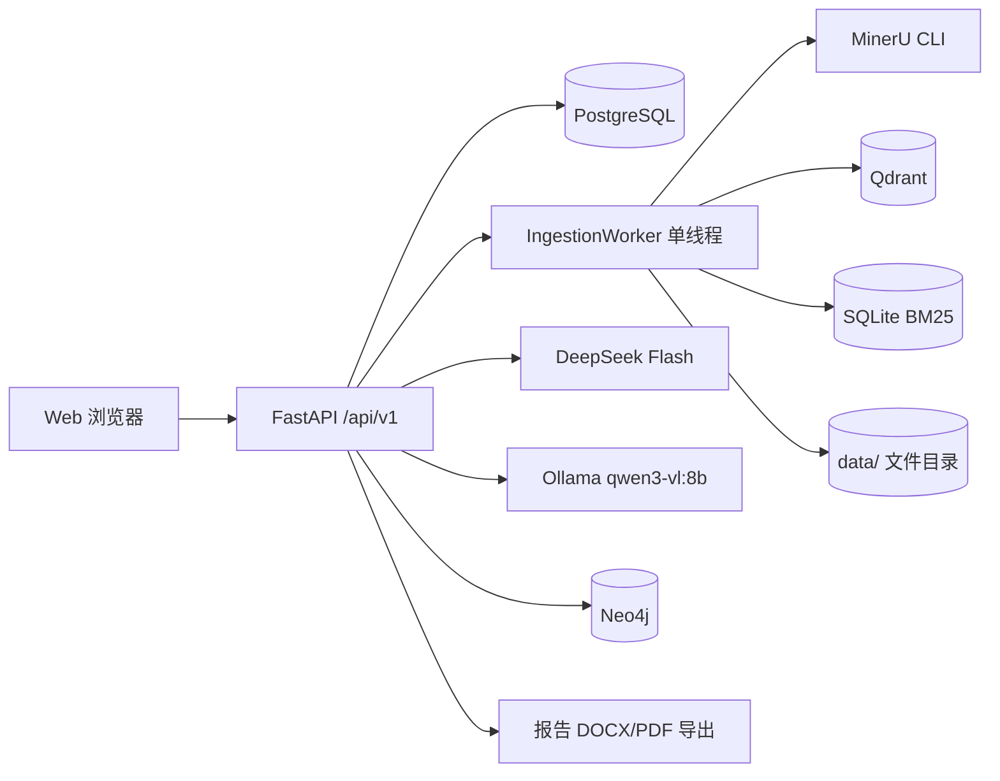
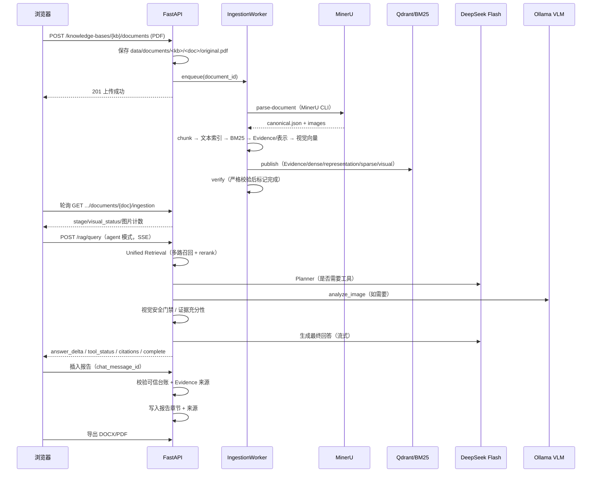

# KnowledgeScope 多模态 Agentic RAG：系统架构与数据流

> 交接文档 A。基于冻结基线 `734fe651b6b0bb242166220ca30fea8ad1a0c7eb`（2026-10-26）整理。
> 本文只描述已经实现并可在本机运行的能力；未实现或存在限制的部分单独标注。

## 1. 系统定位

KnowledgeScope 是一个面向 PDF 知识库的多模态 Agentic RAG 系统：

- PDF 从网页上传后自动完成解析、分块、文本/BM25/多模态/视觉索引。
- 检索层在 chunk、Evidence 和多模态表示之上提供 dense / sparse / graph / multimodal / visual 多路召回与统一排序。
- Agent 层可以调用检索、图片理解（VLM）和表格确定性计算工具，并带证据充分性检查与最多一次补检索。
- 视觉数值有服务端安全门禁；报告创作支持把可信回答连同真实 Evidence 来源插入文档并导出 DOCX/PDF。

**明确的非目标（当前未实现）**：LangGraph/多智能体编排、无限 ReAct、ColPali 类视觉检索、MinIO 对象存储、Kubernetes、跨机器分布式 worker。

## 2. 技术栈与部署拓扑

| 层 | 技术 |
| --- | --- |
| 后端 | Python 3.12、FastAPI、SQLAlchemy async、Alembic、Pydantic v2 |
| 前端 | Vue 3 + TypeScript + Composition API、Vue Query、Element Plus、Vite |
| 关系库 | PostgreSQL（知识库、文档、聊天、报告、ChatBI 元数据） |
| 向量检索 | Qdrant（chunk 文本、多模态 representation、视觉图片三个独立集合） |
| 稀疏检索 | 本地 SQLite BM25 索引 |
| 图谱 | Neo4j（GraphRAG 分支） |
| PDF 解析 | MinerU 3.4.5（独立运行环境，通过 CLI 调用） |
| 文本嵌入 | Qwen3-Embedding-0.6B（1024 维） |
| Reranker | BGE-reranker-v2-m3（本地 cross-encoder） |
| 视觉嵌入 | Qwen3-VL-Embedding-2B（2048 维，原生图片像素向量） |
| 视觉理解 | Ollama + qwen3-vl:8b（OpenAI 兼容接口） |
| 生成模型 | DeepSeek Flash（OpenAI 兼容接口） |
| 报告导出 | 服务端生成 DOCX / PDF |



## 3. 端到端数据流



## 4. 数据模型与存储

### 4.1 PostgreSQL

核心表（Alembic 管理，生产基线为 0010，本轮未新增迁移）：

- `knowledge_bases`、`documents`：文档只保存 `storage_kind`（managed/external_reference）与 `status`（uploaded/registered），**不新增解析状态枚举**；解析/索引进度保存在文件级任务 JSON。
- `chat_conversations`、`chat_messages`：持久化问答与 citations。
- `reports`、`report_sections`、`report_sources`：报告、章节、来源引用。
- ChatBI 相关表（本交接不涉及）。

### 4.2 文件目录（`KNOWLEDGE_SCOPE_DATA_DIR`，默认 `data/`）

| 路径 | 内容 |
| --- | --- |
| `documents/<kb>/<doc>/original.pdf` | 上传的原始 PDF |
| `parsing/<doc>/canonical.json`、`mineru/` | CanonicalDocument 与图片素材 |
| `chunking/<doc>/chunks.json` | 分块结果 |
| `evidence/<doc>/evidence.json` | Evidence 与其表示的 lineage |
| `ingestion/tasks/<doc>.json` | 自动入库任务状态 |
| `ingestion/<doc>/bundle.json` | 待发布索引 bundle |
| `agent-trust/<trust_id>.json` | 回答可信台账（HMAC 签名） |

### 4.3 Qdrant 集合

- `knowledgescope_chunks_v1`：chunk 文本向量（Qwen3-Embedding-0.6B，1024 维）。
- `knowledgescope_representations_v1`：多模态表示文本向量（标题/上下文/HTML/Markdown/LaTeX 的文本化表示）。
- `knowledgescope_visual_v1_<model-slug>_<fingerprint>`：原生图片视觉向量（Qwen3-VL-Embedding-2B，2048 维）；集合名绑定模型指纹，避免不同向量空间混用。

### 4.4 BM25 与图谱

- BM25：`data/evaluation/a4-3/sparse.sqlite3`（`KNOWLEDGE_SCOPE_SPARSE_INDEX_PATH`）。按文档级 generation 活动状态提供稀疏召回。
- Neo4j：实体/关系图谱，用于 graph 检索分支；自动入库当前**不构建图谱**，任务状态 `graph=skipped`，不会伪装为已就绪。

## 5. 自动入库链路（M8）

核心文件：

- `src/knowledge_scope/ingestion/worker.py`：单线程队列、状态机、恢复、重试、同文档互斥。
- `src/knowledge_scope/ingestion/steps.py`：各阶段实现与发布/校验/补偿。
- `src/knowledge_scope/ingestion/store.py`：任务与 bundle 的原子 JSON 存储。
- `src/knowledge_scope/api/ingestion.py`：状态/重试/列表 API。
- `src/knowledge_scope/api/documents.py`：上传成功后 enqueue。

阶段顺序：`parse → chunk → text_index → sparse_index → multimodal_index → visual_index → publish → verify → graph(skipped)`。

关键设计：

- **预生成 + 最后发布**：text/sparse/multimodal/visual 阶段先把点/记录写入 bundle，publish 阶段按序写入 Qdrant/BM25/Evidence；publish 失败执行补偿（删除本次已发布索引与 Evidence）。
- **重建保护**：已完成文档再次入队/retry 返回 `rebuild_not_supported`（HTTP 409），避免破坏已有索引；需重建请删除文档后重新上传。
- **严格校验**：verify 校验 chunk 数、dense 点数、representation 点数、BM25 活动代文档记录数、视觉活动代 `(evidence_id, asset_index)` 集合；不依赖“查一条能查到”这种弱校验。
- **图片计数语义**：`image_count` 表示 Evidence 原始图片数；`visual_indexed_count`、`visual_missing_count`、`visual_invalid_count`、`visual_skipped_by_policy` 分别独立计数。
- **视觉就绪状态**：`pending / not_enabled / skipped_no_images / assets_missing / ready / failed`；素材缺失不会伪装成无图或 ready。
- **进程退出恢复**：启动时把 running 阶段标记 interrupted，并按 attempts 上限重排/失败。

## 6. 检索链路

核心文件：

- `src/knowledge_scope/retrieval/unified.py`：多路召回、去重、rerank、视觉配额融合。
- `src/knowledge_scope/retrieval/indexing.py`、`sparse.py`、`representation_index.py`、`visual_index.py`。
- `src/knowledge_scope/rag/service.py`：RAG 问答编排、SSE、上下文预算。
- `src/knowledge_scope/api/app.py`：依赖组装（embedder/reranker/stores/unified/agent）。

召回分支：

| 分支 | 数据来源 | 说明 |
| --- | --- | --- |
| dense | Qdrant chunks | Qwen3-Embedding-0.6B 文本向量 |
| sparse | SQLite BM25 | 关键词召回，活动代过滤 |
| graph | Neo4j | 实体/关系召回，可能为空 |
| multimodal | Qdrant representations | 图片/表格/公式的文本化表示 |
| visual | Qdrant visual | 查询文本 → 原生图片向量，跨模态召回 |

统一排序：合并候选 → 去重 → BGE reranker → 视觉配额补位（explicit 视觉意图 4、ambiguous 1、plain 0）→ 最终 Top-K。不同 embedding 空间的原始分数**不做相加**，视觉候选通过配额与分支来源保留。

## 7. Agentic RAG

核心文件：

- `src/knowledge_scope/agent/service.py`：主流程、SSE 事件、视觉安全门禁、补检索、回答生成。
- `src/knowledge_scope/agent/planner.py`：Planner prompt/调用/校验/修复。
- `src/knowledge_scope/agent/tools.py`：检索工具、图片/表格工具执行器。
- `src/knowledge_scope/agent/evidence.py`：证据需求抽取与充分性评估。
- `src/knowledge_scope/rag/schemas.py`：SSE/complete 契约。

主流程：

1. 准备历史（`HistoryCompressor`）与查询改写（`QueryRewriteService`）。
2. 首次 Unified Retrieval，得到 ≤6 个 AgentCandidate（C1…）。
3. `extract_requirement` + `assess_evidence`：按**逐条 Evidence 绑定**检查对象/年份/指标/关系/单位冲突。
4. 不充分且允许时执行**最多一次**补充检索；合并去重、重新编号、记录 coverage before/after。
5. Planner 循环（最多 3 轮、最多 3 次工具调用）：最终回答或调用 `analyze_image`/`analyze_table`；应用层可在视觉特征问题且 `tool_calls==0` 时兜底调用一次图片分析。
6. 生成回答：流式 `answer_delta`，服务端校验/过滤 [Cx] 标记；`citations` 只保留实际使用或工具使用的候选。
7. `complete` 携带完整 trace、fact_status、safety_gate、visual_sources、证据充分性字段。

预算：`AGENT_MAX_ROUNDS=3`、`AGENT_MAX_TOOL_CALLS=3`；补检索与工具调用分开计数；重复工具调用（同图同参数）会被跳过。

## 8. 视觉数值安全门禁与可信台账

- 每个工具结果携带 `fact_status`：`source_verified`（确定性表格计算）/`visual_estimate`/`unverified`/`not_available`；`agent_tool_trace[].fact_status` 可审计。
- 高风险视觉数值问题由 `vision/safety.py` 的风险分类器识别；命中时**不启动 LLM 流式生成**，直接输出确定性安全回答，避免先泄漏再警告。
- 混合工具场景：表格结果不会把视觉数字“洗白”为已验证；回答会明确说明视觉估计需人工核对。
- 确定性表格结果的展示由应用层按 `TableAnalysisResult.columns[].unit` 逐列渲染：绝对变化沿用输入单位，相对变化固定 `%`，百分数指标的绝对变化使用“百分点”；模型不参与单位与数值改写（M10 后补丁 PR #70）。
- 回答完成后写入 `<data_dir>/agent-trust/<trust_id>.json`（HMAC-SHA256 签名，绑定 conversation/KB/content/citations）。报告插入只接受验证通过的服务端记录；客户端伪造 assistant 消息插入返回 409。

## 9. 报告创作与可信来源插入

核心文件：`src/knowledge_scope/reports/api.py`、`schemas.py`、`models.py`、`export.py`。

- `POST /reports/{id}/sections/{section_id}/agent-answers/insert` 只接受 `chat_message_id`；服务端读取持久化回答、验证可信台账、从 citations 重建来源（不接受客户端来源字段）。
- 视觉未核验数值：回答含数字时 409 拒绝；无数字的视觉草稿插入时正文加“⚠️ 视觉分析草稿，需人工核对”并返回 warning。
- 来源校验：KB 一致、Evidence 页/块一致性、历史缺失产物降级 warning；写入章节与来源在同一事务提交。
- 导出：`GET /reports/{id}/export/docx`、`/export/pdf`，保留正文、来源与视觉告警。

## 10. 关键配置（默认值，实际以 `.env` 覆盖）

| 配置 | 默认 | 说明 |
| --- | --- | --- |
| `KNOWLEDGE_SCOPE_INGESTION_ENABLED` | true | 自动入库 worker |
| `KNOWLEDGE_SCOPE_VISUAL_EMBEDDING_ENABLED` | false | 视觉向量索引/检索 |
| `KNOWLEDGE_SCOPE_VISUAL_MODEL_PATH` | - | 本地视觉模型目录 |
| `KNOWLEDGE_SCOPE_VISUAL_DEVICE/DTYPE` | cuda/bfloat16 | 视觉编码设备 |
| `KNOWLEDGE_SCOPE_VLM_ENABLED` | false | 图片理解 |
| `KNOWLEDGE_SCOPE_VLM_BASE_URL/MODEL` | - | Ollama OpenAI 兼容地址与模型名 |
| `KNOWLEDGE_SCOPE_AGENT_EVIDENCE_SUFFICIENCY_ENABLED` | true | 证据充分性检查 |
| `KNOWLEDGE_SCOPE_AGENT_VISUAL_TOOL_AUTO` | true | 视觉工具应用层兜底 |
| `KNOWLEDGE_SCOPE_AGENT_MAX_ROUNDS/TOOL_CALLS` | 3/3 | Agent 预算 |
| `KNOWLEDGE_SCOPE_AGENT_TRUST_SECRET` | 自动生成本地密钥文件 | HMAC 台账签名密钥 |
| `KNOWLEDGE_SCOPE_MINERU_COMMAND` | `mineru` | MinerU 可执行文件绝对路径 |

## 11. 可复现命令（本机已验证）

```bash
# 依赖
uv sync --frozen
docker compose up -d
uv run alembic upgrade head
cd frontend && npm install && npm run dev

# 启动 API（本机演示使用 CPU 文本/视觉 + GPU VLM 的组合，避免 12GB 显存 OOM）
PYTHONPATH=src KNOWLEDGE_SCOPE_DATA_DIR=/tmp/demo-data \
KNOWLEDGE_SCOPE_MINERU_COMMAND=/home/amber/.local/share/knowledgescope/mineru-3.4.5/bin/mineru \
KNOWLEDGE_SCOPE_VISUAL_EMBEDDING_ENABLED=true \
KNOWLEDGE_SCOPE_VISUAL_MODEL_PATH=/home/amber/.cache/knowledgescope/qwen3-vl-embedding-2b \
KNOWLEDGE_SCOPE_VISUAL_DEVICE=cpu \
uv run uvicorn knowledge_scope.api.app:app --host 127.0.0.1 --port 8000

# 手工建视觉索引（GPU 一次性构建；查询可换 CPU）
uv run knowledgescope visual-index build --knowledge-base-id <kb_id> --mode all

# Agent 问答（SSE）
curl -N -X POST http://127.0.0.1:8000/api/v1/rag/query \
  -H 'Content-Type: application/json' \
  -d '{"query":"分析图 1 中柱状图的季度销售额趋势","knowledge_base_id":"<kb_id>","retrieval_mode":"unified","answer_mode":"agent"}'

# 报告插入（必须使用真实对话消息 id）
curl -X POST http://127.0.0.1:8000/api/v1/reports/<report_id>/sections/<section_id>/agent-answers/insert \
  -H 'Content-Type: application/json' -d '{"chat_message_id":"<message_id>"}'

# 导出
curl -o report.docx http://127.0.0.1:8000/api/v1/reports/<report_id>/export/docx
curl -o report.pdf  http://127.0.0.1:8000/api/v1/reports/<report_id>/export/pdf
```

MinerU 独立环境：

```bash
/home/amber/.local/share/knowledgescope/mineru-3.4.5/bin/mineru --version   # 3.4.5
```

## 12. 已知边界

- 自动入库的 graph 阶段不构建图谱（`graph=skipped`）。
- 视觉索引模型与集合强绑定；更换模型需重建集合。
- `rebuild_not_supported`：已完成文档不支持原地重建，需删除后重传（为避免破坏旧索引的保守设计）。
- 历史语料图片资产仅约 23% 可解析到原始图片；历史文档的视觉索引覆盖有限。
- VLM 输出可能被截断或出现视觉估计误差，系统会降级/门禁，但不能保证视觉事实绝对正确。
- 报告插入仅验证来源元数据与可信台账，不保证正文每一句话都有语义支撑。
