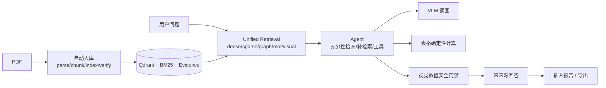

# KnowledgeScope 面试技术交接

> 交接文档 C。目标：能自然讲清项目价值、架构、关键难点与取舍，不背虚假指标。

## 1. 两分钟项目介绍

KnowledgeScope 是一个面向 PDF 知识库的多模态 Agentic RAG 系统。用户从网页上传 PDF 后，系统自动用 MinerU 解析出文本、表格、公式和图片，建立 chunk 文本索引、BM25 索引、多模态 Evidence 表示，以及原生图片的视觉向量索引。问答时，统一检索层会融合 dense / sparse / graph / 多模态 / 视觉多路召回并做 rerank；复杂问题会进入 Agent：先做证据需求检查，不足时最多补充检索一次，再按需调用图片理解或表格确定性计算工具，最后生成带真实来源的回答。回答还可以插入报告章节并导出 DOCX/PDF。

我做的不是“接一个大模型 API”，而是把多模态检索、证据追踪、数值安全、报告可信插入这几条链路做成可运行、可验证、可降级的系统。

## 2. 一句话架构

`FastAPI + PostgreSQL + Qdrant + Neo4j + BM25 + MinerU + DeepSeek Flash + Ollama Qwen3-VL + Vue3`：
自动入库 Worker 负责把 PDF 变成可检索的多模态索引；Unified Retrieval 负责召回；Agent 负责按证据需求做工具调用；安全层负责阻止未核验视觉数值进入可信结论与报告。

## 3. 五个最有价值的技术难点

### 3.1 视觉嵌入模型加载陷阱：SentenceTransformer 静默加载随机权重

- 背景：Qwen3-VL-Embedding-2B 是跨模态检索模型，官方示例用 SentenceTransformer。
- 问题：加载没有报错，但权重大面积 “newly initialized”；原因是 checkpoint 是 `Qwen3VLForConditionalGeneration`（键带 `model.` 前缀），而 ST 加载的是 `Qwen3VLModel`，键不匹配，得到的是随机向量。评测会“看起来能跑”，实际毫无检索意义。
- 解决：绕开 ST，直接 `Qwen3VLForConditionalGeneration.from_pretrained(...).model`，自写只保留 text/image 的 processor（避免 torchvision/video 依赖），用 chat template + 最后一个非 pad token pooling + L2 normalize；2048 维。
- 结果：加载约 9–13s，GPU 查询编码 P50 20.7ms，CPU 982.8ms；A/B/C 实验中视觉索引 Recall@5 从文本 25.0% 提升到 92.9%。
- 代码：`src/knowledge_scope/retrieval/visual_embedding.py`（`_ImageOnlyQwen3VLProcessor`、`VisualEmbeddingEncoder._encode_batch`）。
- 可讲点：**评测前必须先验证模型权重真的加载成功**（比对 checkpoint 键、验证权重大小/是否 newly initialized），否则会得到伪结论。

### 3.2 视觉索引失败安全切换：generation + pointer

- 背景：重建文档视觉索引时，如果先删旧再写新，编码/写入失败会丢失旧索引；如果先写新再删旧，又可能新旧双份可见。
- 解决：文档级 generation + 单点 pointer。新 generation 点为 pending（不可见）→ 编码成功 → 写入新点 → 一次 pointer 写入完成可见性切换 → 标记 active → 清理旧代；search 以 pointer 为准，pending/旧代/pointer 点都不参与结果；recover_document 在崩溃后只保留已提交代。
- 结果：真实 Qdrant 验收覆盖 pointer 前/后退出、并发查询（0 空结果/0 混代）、首次构建残留、重复构建/删除；主集合不受影响。
- 代码：`src/knowledge_scope/retrieval/visual_index.py`（`replace_document`、`search`、`recover_document`、`document_active_records`）。
- 可讲点：**跨 Qdrant/文件系统/BM25 没有事务**，只能做文档级最终一致性；要明确一致性边界，而不是宣称“原子切换”。

### 3.3 混合模态数值安全门禁：表格不能给视觉数字“洗白”

- 背景：VLM 能读图，但可能猜出未标注的精确数字；如果直接流式输出并附 `[C1]`，会被误认为已验证事实。
- 解决：
  - 每个工具结果带 `fact_status`（`source_verified`/`visual_estimate`/`unverified`/`not_available`），再由应用层写进 `agent_tool_trace`。
  - 高风险视觉数值问题不启动 LLM 流式生成，直接输出确定性安全回答（避免 SSE 先泄漏再警告）。
  - 混合表格+视觉：表格结果只证明表格字段，不证明视觉数字；高风险表格回答先缓冲，数字必须能在表格 payload 中找到，否则替换为确定性结果。
  - 可信台账：回答完成后写 HMAC 签名的 `TrustedAnswer`，报告插入只接受验证通过的服务端记录，客户端伪造 assistant 消息插入返回 409。
- 结果：真实浏览器/API 验收：图片问题显示真实原图 + “视觉分析结果需核对”；伪造插入 409；视觉数值回答插入 409；可信表格回答插入 201 + 来源。
- 代码：`src/knowledge_scope/vision/safety.py`、`src/knowledge_scope/agent/service.py`（`_needs_visual_number_gate`、`_safety_gated_events`、`_answer_events`）、`src/knowledge_scope/chat/trust.py`、`src/knowledge_scope/reports/api.py`。
- 可讲点：**安全边界要在应用层，而不是 Prompt 或 UI 警告**；模型自报 confidence 不可信。

### 3.4 证据充分性与最多一次补检索：从“召回 6 条”到“逐条 Evidence 绑定”

- 背景：Agent 常见错误是“候选里同时出现国家、年份、指标词”就认为证据够了，或者 Planner 直接 final。
- 解决：
  - `extract_requirement` 抽取对象/年份/指标/关系/图片/表格/比较需求。
  - `assess_evidence` 逐条 Evidence 绑定：同一候选必须同时覆盖对象+年份+指标（或关系词），不能跨候选拼凑；单位冲突强制不充分；图片证据必须绑定对象/关系。
  - 不足且允许时，构造补充查询做**最多一次**补检索，合并去重、重新编号、记录 coverage before/after；补检索不计入工具调用预算。
  - Planner 对视觉特征问题有 Image Evidence 时优先 `analyze_image`；应用层再加一层兜底，避免 Planner 漏调。
- 结果：15 题技术评测（真实 DeepSeek Flash + Qwen3-VL）：Tool Selection 14/15→15/15、Sufficiency 8/9→9/9、Supplementary 6/9→9/9、E2E 11/15→14/15；延迟 mean 34.4s→42.4s。
- 代码：`src/knowledge_scope/agent/evidence.py`、`src/knowledge_scope/agent/service.py`（`_merge_candidates`、`_auto_visual_plan`）、`src/knowledge_scope/agent/planner.py`。
- 可讲点：**证据充分性是检索/Agent 的系统问题，不是换更强模型就能解决**；词面绑定仍有局限（不能证明语义支撑），需要如实说明。

### 3.5 自动入库编排与失败恢复：先预生成，再发布，再严格校验

- 背景：上传 PDF 后要自动完成解析、chunk、四类索引，且不能阻塞 HTTP、不能重复索引、失败不能破坏旧数据。
- 解决：单线程 worker；阶段状态机；文本/BM25/多模态/视觉阶段先写 bundle，publish 按序写入并在失败时补偿；verify 用活动代文档记录数/点数/`(evidence_id, asset_index)` 集合严格校验；已完成文档重入返回 409，避免破坏旧索引；图片计数拆成 evidence/visual 多字段，素材缺失不会被当成“无图”。
- 结果：网页上传全自动；两文档从上传到 ready 约 3.5 分钟（CPU 视觉/publish 是瓶颈）；失败重试、BM25 缺失、视觉点缺失、无图文档均有真实验收。
- 代码：`src/knowledge_scope/ingestion/{worker,steps,store,models}.py`、`src/knowledge_scope/api/ingestion.py`、`src/knowledge_scope/api/documents.py`。
- 可讲点：**把“索引构建”当分布式事务会过度设计**，文档级预生成+发布+校验+补偿足够；但要明确不保证跨存储原子性。

## 4. 常见追问与回答要点

1. **为什么不用 LangGraph？**
   当前是 3 个固定工具 + 有界循环（3 轮/3 次工具），用显式状态机和事件流更容易做安全门禁、预算控制与可解释 trace；LangGraph 会引入额外抽象，收益不明确。

2. **视觉向量召回和 VLM 是什么关系？**
   视觉向量负责“找到正确的图片”，VLM 负责“读懂图片”。检索对了不代表 VLM 数值正确，所以还有安全门禁：视觉估计不升级为可信统计。

3. **为什么选择全量视觉索引，而不是按复杂度选择性索引？**
   A/B/C 实验显示 selective 仅跳过 4/502 张，成本节省 <1%，而 caption 覆盖只有 28.6%；本语料下全量更简单且召回不降。承认这是数据特性导致的结论，不宣称通用。

4. **12GB 显存怎么部署？**
   VLM 占 GPU（约 7.2GB），文本嵌入/reranker/视觉查询编码放 CPU；GPU 峰值约 8.9GB，不 OOM。代价是 CPU 视觉查询编码约 983ms（P50），比 GPU 20.7ms 慢很多。

5. **怎么保证 Report 里插入的内容可信？**
   只接受 `chat_message_id`，服务端读持久化回答并验证 HMAC 台账；来源由服务端从 citations 重建；视觉未核验数字直接 409；草稿插入保留警告。局限是只验证来源元数据与生成记录，不保证正文每句话语义正确。

6. **评测指标是怎么算的？**
   M9 是 15 道技术测试题，Tool/Sufficiency/Supplementary/Coverage/Visual/Answer/E2E 是按 gold 字段匹配；14/15 不是整体语义准确率，也没做人工逐题语义核验。M7 是 28 条人工视觉查询、A/B/C 三种索引。不同集合数字不能混用。

7. **最大的坑是什么？**
   SentenceTransformer 静默随机初始化视觉模型权重；以及混合工具时表格成功把视觉数字误标为已验证。前者靠“权重加载校验 + 检索 sanity check”，后者靠 fact_status 与门禁。

## 5. 未解决的边界（面试时主动说）

- 视觉事实准确性无法根本保证：门禁只能阻止未核验数字进入可信结论，不能防止 VLM 把图看错。
- 证据充分性是词面绑定，不能证明语义支撑；复杂多跳问题仍可能不足。
- 跨语言表头（中文“国家” vs 英文“Country”）会导致表格对比工具失败，需要人工降级。
- 历史语料图片资产仅约 23% 可解析，旧文档视觉索引覆盖有限。
- 自动入库 publish 阶段较慢（60–80s），CPU 视觉编码慢；生产化需要任务队列/并行/缓存优化。
- 视觉索引重建需删除文档后重传（`rebuild_not_supported`），运维友好性不足。
- 报告插入前端对 409 detail 展示为通用错误；确定性表格回答的百分比单位标注存在 bug；这些已记录但未在冻结期修复。

## 6. 简历/面试表述注意

可以写：

- “设计并实现 PDF 自动入库流水线（MinerU 解析 + 四类索引 + 失败恢复 + 严格校验）。”
- “实现原生图片视觉向量检索（Qwen3-VL-Embedding-2B），A/B/C 实验中视觉召回 Recall@5 从 25.0% 提升到 92.9%。”
- “实现多模态 Agentic RAG 的证据充分性检查与最多一次补检索，15 题技术评测 E2E 从 11/15 提升到 14/15。”
- “设计视觉数值安全门禁与报告可信插入（HMAC 台账），阻止未核验视觉数值进入可信结论。”

不要写：

- “语义准确率 100%”“引用真实性 100%”等未人工核验的说法。
- “国别经济研究报告评测”——实际是技术报告/生成测试 PDF。
- “支持视觉推理/复杂图表理解”——实际能力是图片描述/图表趋势/图片表格提取，且有失败与限制。
- “全链路生产级/高可用”——当前是单机、单线程入库、本地视觉模型。

## 7. 演示顺序建议（15 分钟）

1. 打开知识库页，上传一个含图表和表格的 PDF，展示自动入库状态从解析到视觉索引就绪。
2. 普通文本问答：展示引用来源与原文页码。
3. 智能体图片问题：展示工具轨迹、真实原图卡片、视觉估计提示。
4. 表格问题：展示确定性计算过程与结果（10.6977%）。
5. 多证据/补检索问题：展示“补充检索”轨迹与失败降级说明。
6. 报告：插入可信回答、预览、导出 DOCX/PDF；演示未核验视觉数值插入被拒绝（API/浏览器）。
7. 最后主动讲指标口径与已知限制。
